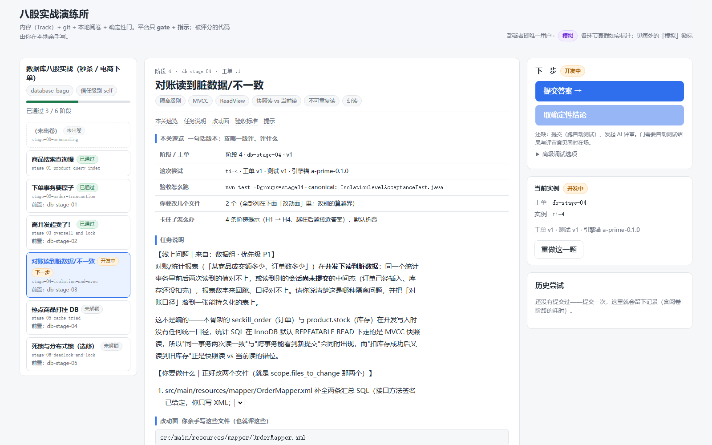

<div align="center">

# 发卷平台 · bagu-trainer

**开源、可自托管的八股实战演练所** —— 一个人刷题用的：平台发工单、你亲手写代码、
确定性验收门决定过没过、过了才解锁下一关。

[](LICENSE)
[](pyproject.toml)
[](frontend)

[部署](docs/deployment.md) · [开发与验证](docs/development.md) · [内部机制](docs/internals.md) ·
[设计文档](docs/paper-platform-design.md) · [工单写作规范](docs/工单写作规范.md) · [全部文档](docs/README.md)



<sub>左栏选阶段，中栏读题（Markdown 文档），右栏点下一步；题面、你的改动、阅卷报告、评审与判定在同一篇文档里。</sub>

</div>

## 快速开始

需要两样东西：一个**内容 Track**（题目来源，如 [`seckill-lab`](https://github.com/OnlyblackTea/seckill-lab)）
和一个**后端能读到的 git 远端**。最省事的一条命令起全（Gitea + 后端 + 前端，启动时自动把 Track 载入 Gitea）：

```bash
git clone https://github.com/OnlyblackTea/bagu-trainer && cd bagu-trainer
git clone https://github.com/OnlyblackTea/seckill-lab ../seckill-lab   # 内容 Track
cd deploy && cp .env.example .env && docker compose up -d
# 打开 .env 里 WEB_PORT 那个端口（默认 8081）
```

<details>
<summary><b>其他起法（裸机两条命令 / 只读设计不想起 Gitea）</b></summary>

```bash
# 裸机（自己管 venv、依赖与前端构建）
bash scripts/quickstart.sh --content-dir ../seckill-lab

# 开发用：后端 + Vite 两个终端（进度存 ./bagu.sqlite3）
.venv/Scripts/python.exe -m platform_api.serve --content-dir ../seckill-lab   # :8000
cd frontend && npm install && npm run dev                                    # :5173
```

细节与排障见 [`deployment.md`](docs/deployment.md) 与 [`deploy/README.md`](deploy/README.md)。

</details>

## 一次练习长什么样

| 步骤 | 你做什么 | 平台做什么 |
|---|---|---|
| 开题 | 在左栏点一个已解锁阶段 | 发工单（题面 / 改动面 / 验收标准 / 阶梯提示），按题目版本铸一个尝试 |
| 开发 | 在**你自己的** `dev` 分支上写代码、`git push` | 只读地 clone 你要的那份工作区，给出 diff 与对账结果——**不替你跑任何 git 写操作** |
| 提交 | 点「提交答案」 | 重置 Track 的基础设施，跑 canonical 测试（真阅卷），把逐条红绿写进报告 |
| 评审 | 看一眼 AI 评审意见（可缺席） | 把评审当**一路输入**，与测试结果一起交给确定性门 |
| 判定 | 通过 → 做下一关；没过 → 改完再交 | 测试绿 + 评审放行 = 通过并解锁后继；判定面被动过则**绿也算不过** |

平台里**没有会写业务代码的组件**（没有 Executor 这个座位），也**不跑 git 写操作**——
这是结构性的，不是靠"禁用工具"守出来的。为什么、代价是什么：见[设计文档](docs/paper-platform-design.md)。

## 它是什么

- **一道题一次尝试，状态机说了算。** 未解锁的阶段不在工作区里；每次提交都留档（提交 + 运行记录 +
  报告 + 评审 + 判定），可以看"这次比上次好在哪"。[内部机制](docs/internals.md#历史查询与比对)
- **确定性验收门，不是 LLM 打分。** 硬门只认两样证据：Track 的 canonical 测试真跑出来的红绿，
  与评审意见。AI 缺席时闭环照走；接上再强的模型也越不过测试。
- **真阅卷跑在你自己那台机器上。** 平台中心零阅卷算力、零强制 LLM 成本——重置基础设施、`mvn test`、
  解析 surefire 都在本地。[怎么开](docs/development.md#真阅卷不是桩)
- **代码写在哪儿都行。** 工作区（你写代码的 clone）可以在任何机器上，只要能把 `dev` push 到内容仓、
  后端读得到；平台在提交前自动把它的 checkout 快进到你的 push，并对不上时如实报出来。
- **内容与平台分家。** 一道题 = 一个 `ticket.yaml` + 一份 canonical 测试（骨架红、参考解绿）。
  换 Track 不用改平台一行代码。[工单写作规范](docs/工单写作规范.md)

## 现状与变更

发卷 → 工作区 → 提交 → **真阅卷** → 评审 → 确定性判定 → 解锁，整条路已在真 Gitea + 真 MySQL/Maven
上端到端跑通；AI 评审目前是桩（设计为可选挂件）。逐项状态、路线图与未决问题见
[设计文档](docs/paper-platform-design.md) §14 与附录 C。

- **v0.6（L3）**：真 Gitea 的形态改为**一个内容仓 + 学员直接 push `dev`**——fork 与 PR 一并废弃。
  理由与代价见设计 §8.3。
- **v0.5**：原先由 prar-agent 引擎驱动（AI 经理发卷 / 导师陪练 / AI 评审）的设计**已退休**，
  决策记录见设计 §6 与 [`docs/superpowers/specs/`](docs/superpowers/specs)。

## 贡献

- **加一个 Track / 扩八股面**：按 [`content/schema/`](content/schema) 写 `track.yaml` 与
  `stages/*/ticket.yaml`，补齐 canonical 测试（骨架红 / 参考解绿）与八股地图，向目录仓开 PR；
  准入门 `admission.validate_track` 会硬卡一批硬条件。
- **改平台**：在本仓走正常 PR —— Apache-2.0。
- **改题目内容**：去对应的 Track 仓（如 `seckill-lab`）；本仓不内置 Track。

## 许可

[Apache-2.0](LICENSE) —— 见 [LICENSE](LICENSE) 与 [NOTICE](NOTICE)。
